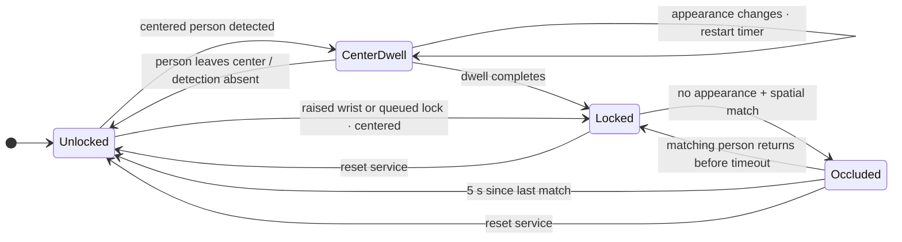
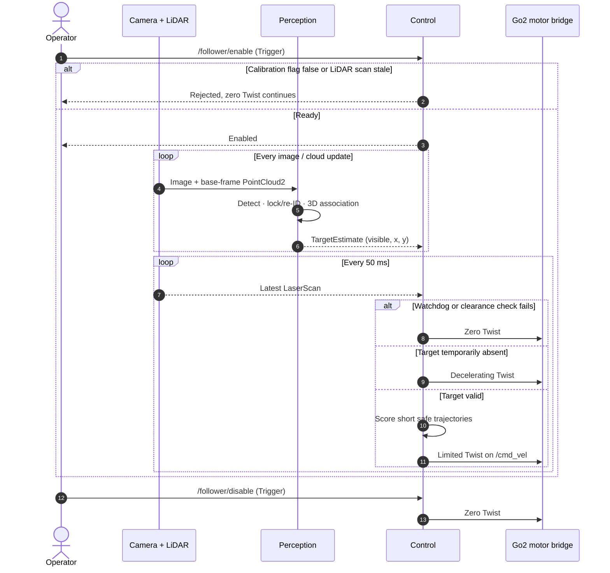

# Architecture

> **Snapshot:** the code on `main` as reviewed on 2026-11-25. This is an off-robot prototype. The diagrams describe implemented paths; the [verification boundary](#verification-boundary) lists what still needs measurement on a Go2 and Jetson.

The follower has one job: keep a selected person in view and at a configured distance while using nearby LiDAR returns to choose a short, collision-aware velocity command. Sensor access, person identity, metric position, and motion control live in separate ROS 2 packages so each can be tested or replaced without changing the others.

## System at a glance

```mermaid
flowchart LR
    subgraph physical["GO2 · physical world"]
        camera["Front camera"]
        lidar["4D LiDAR"]
        robot["Go2 locomotion"]
    end

    subgraph ingest["01 · sensor ingress  |  go2_follower_perception"]
        camera_adapter["camera_adapter<br/>SDK2 / webcam / disabled"]
        image(["/go2/camera/image_raw<br/>Image · bgr8"])
        lidar_adapter["lidar_adapter<br/>static extrinsics + height slice"]
        cloud(["/follower/cloud_base<br/>PointCloud2 · base_link"])
        scan(["/follower/scan<br/>LaserScan · base_link"])
    end

    subgraph perceive["02 · identify + locate  |  go2_follower_perception"]
        detector["PoseDetector<br/>YOLOv8 pose ONNX"]
        tracker["TargetTracker<br/>gesture / dwell · color + motion"]
        fusion["3D fusion<br/>camera box ↔ cloud cluster"]
        estimate(["/follower/target<br/>TargetEstimate · base_link"])
    end

    subgraph drive["03 · decide + command  |  go2_follower_control"]
        gate["FollowController<br/>enable gate · watchdog · braking"]
        planner["sampled local planner<br/>2.5 s trajectories"]
        command(["/cmd_vel<br/>Twist"])
        state(["/follower/state<br/>FollowerState"])
    end

    bridge["Existing Go2 motor bridge"]
    operator["Operator<br/>lock / reset · enable / disable"]
    model["External licensed<br/>pose ONNX model"]
    bag["ROS bag or webcam<br/>offline input"]

    camera -- "SDK2 JPEG" --> camera_adapter --> image --> detector --> tracker --> fusion --> estimate --> gate
    lidar -- "/utlidar/cloud" --> lidar_adapter --> cloud --> fusion
    lidar_adapter --> scan --> gate --> planner --> command --> bridge --> robot
    gate --> state
    model -. "loaded at startup" .-> detector
    bag -. "offline input" .-> image
    bag -. "recorded cloud" .-> lidar_adapter
    operator -. "Trigger services" .-> tracker
    operator -. "Trigger services" .-> gate

    classDef physical fill:#172554,stroke:#60a5fa,color:#fff,stroke-width:2px
    classDef sensor fill:#0f766e,stroke:#5eead4,color:#fff,stroke-width:2px
    classDef perception fill:#6d28d9,stroke:#c4b5fd,color:#fff,stroke-width:2px
    classDef control fill:#9a3412,stroke:#fdba74,color:#fff,stroke-width:2px
    classDef topic fill:#f8fafc,stroke:#64748b,color:#0f172a,stroke-width:2px
    classDef optional fill:#e2e8f0,stroke:#64748b,color:#0f172a,stroke-dasharray:5 3
    class camera,lidar,robot,bridge physical
    class camera_adapter,lidar_adapter sensor
    class detector,tracker,fusion perception
    class gate,planner control
    class image,cloud,scan,estimate,command,state topic
    class operator,model,bag optional
```

The motor bridge, pose model, and robot firmware are external. This repository owns the four packages in `src/` and publishes only standard ROS 2 motion commands to the bridge. `go2_follower_interfaces` defines `TargetEstimate` and `FollowerState`; `go2_follower_bringup` owns launch and YAML configuration.

## Package boundaries

| Package | Responsibility | Main code |
| --- | --- | --- |
| `go2_follower_interfaces` | ROS message contracts | [`TargetEstimate.msg`](../src/go2_follower_interfaces/msg/TargetEstimate.msg), [`FollowerState.msg`](../src/go2_follower_interfaces/msg/FollowerState.msg) |
| `go2_follower_perception` | Camera and LiDAR adapters, pose detection, identity lock, 3D association | [`camera_adapter.py`](../src/go2_follower_perception/go2_follower_perception/camera_adapter.py), [`lidar_adapter.py`](../src/go2_follower_perception/go2_follower_perception/lidar_adapter.py), [`detector.py`](../src/go2_follower_perception/go2_follower_perception/detector.py), [`tracker.py`](../src/go2_follower_perception/go2_follower_perception/tracker.py), [`fusion.py`](../src/go2_follower_perception/go2_follower_perception/fusion.py), [`perception_node.py`](../src/go2_follower_perception/go2_follower_perception/perception_node.py) |
| `go2_follower_control` | Target/lidar watchdog, protective stops, sampled trajectory selection, velocity output | [`controller.py`](../src/go2_follower_control/go2_follower_control/controller.py), [`planner.py`](../src/go2_follower_control/go2_follower_control/planner.py), [`control_node.py`](../src/go2_follower_control/go2_follower_control/control_node.py) |
| `go2_follower_bringup` | Shared parameters and two launch modes | [`follower_params.yaml`](../src/go2_follower_bringup/config/follower_params.yaml), [`follower.launch.py`](../src/go2_follower_bringup/launch/follower.launch.py), [`sim_or_offline.launch.py`](../src/go2_follower_bringup/launch/sim_or_offline.launch.py) |

The detector, tracker, fusion, scan projection, controller, and planner expose ROS-independent Python logic. ROS subscriptions, timers, services, and publishers stay in the adapter/node entry points. This is why `tests/` can exercise decisions without starting a ROS graph.

## From sensors to a metric target

### 1. Camera ingress

`camera_adapter` has three modes. `sdk` initializes the public Unitree Python SDK on the configured network interface, requests a JPEG frame through `VideoClient.GetImageSample()`, decodes it with OpenCV, and publishes an `Image` with `bgr8` encoding at the configured `camera_fps` (default 8). `webcam` reads a local V4L2 device through OpenCV. `disabled` creates no camera timer so a bag or another publisher can supply `/go2/camera/image_raw`.

The repository does not ship a camera calibration matrix. The fusion code currently uses configured horizontal/vertical field of view and camera pose instead. These values in YAML are **placeholders**.

### 2. LiDAR ingress and two views of the same cloud

`lidar_adapter` subscribes to `/utlidar/cloud` as `sensor_msgs/PointCloud2` using sensor-data QoS. It applies a configured translation and yaw rotation to produce `/follower/cloud_base` in `base_link`. It also selects points in a configured height interval (default 0.05–0.7 m), projects the nearest return into each of 721 angular bins over −π to +π, and publishes `/follower/scan`. The scan is used for obstacle checks; the full transformed cloud is used to locate the person.

This adapter does **not** query TF or apply LiDAR roll/pitch. Confirm the incoming cloud frame and measure its transform to `base_link` before a live run. Returns outside the configured height/range slice are not considered by the controller.

### 3. Detection, lock, and identity

`PoseDetector` expects an external COCO 17-keypoint YOLOv8 pose ONNX file. OpenCV DNN runs the model; the decoder expects 56 values per candidate (box, confidence, 17 × 3 keypoint values). It uses a default confidence threshold of 0.5 and non-maximum suppression. A wrist above its shoulder is the implemented gesture; it is a simple keypoint comparison, not a general gesture classifier.

`TargetTracker` stores an 8×8 torso HSV histogram and an image-center velocity estimate for the locked person. Without a gesture or service request, a candidate must stay within 15% of image center for `lock_dwell_s` (default 2 s); a change in appearance restarts the dwell. `/follower/lock_target` queues a lock of the next centered candidate, while `/follower/reset_target` clears the lock. After locking, candidates need sufficient appearance similarity and proximity to the predicted image position. No match leaves the lock intact briefly; `loss_timeout_s` (default 5 s) releases it.

These are conceptual tracker states; the code stores `locked`, dwell timestamps, and last-seen time rather than a state enum. Similar clothing, lighting shifts, and long occlusions can still cause identity mistakes. The tracker is a lightweight color/spatial matcher, not an OSNet or BoT-SORT implementation.

### 4. Camera–cloud association

`perception_node` projects recently received `/follower/cloud_base` points into the selected person's image box using the configured camera position, yaw, pitch, and field of view. The fusion function rejects nonfinite/behind-camera points and points outside the inner box. It selects the nearest group of at least three points whose range spread is at most 0.35 m, then publishes the group's median `(x, y)` as `TargetEstimate` in `base_link`. The message also carries `confidence` and `visible`.

The node publishes `visible=false` when detection, model loading, recent cloud data, or association fails. Cloud recency is checked against arrival time (default 0.5 s); image and cloud header stamps are **not synchronized**. A foreground object projected inside the box can be mistaken for the person. The controller treats `visible=false` as target loss and reduces speed.

## From target to motion

`control_node` ticks every 0.05 s (20 Hz). `/follower/enable` succeeds only when `calibration_verified` is true **and** a fresh scan has arrived. Launch starts with motion disabled. `/follower/disable` immediately publishes a zero `Twist`. `/follower/state` reports the controller's current state string; `detail` is currently empty.

Safety decisions happen before planning, in this order:

| Condition | Code state | Command |
| --- | --- | --- |
| Not enabled | `DISABLED` | Zero |
| No scan or scan older than `sensor_timeout_s` (0.5 s) | `SENSOR_STALE` | Zero |
| Fewer than three valid returns overall / in the forward ±60° sector | `SCAN_EMPTY` / `FRONT_SCAN_EMPTY` | Zero |
| Forward ±45° obstacle within `safety_bubble_m + v²/(2·max_accel_mps2) + 0.2 m` | `BRAKING_STOP` | Zero |
| Any valid obstacle inside `safety_bubble_m` (0.35 m) | `BUBBLE_STOP` | Zero |
| Target absent, expired, or stale | `WAITING_TARGET` / `TARGET_LOST` / `TARGET_STALE` | Ramp toward zero or stop |
| Fresh target and scan | `FOLLOWING` / `HOLDING` | Sampled local command |

The local planner samples five linear and nine angular velocities. Each candidate is simulated for 25 steps of 0.1 s, rejects paths that approach an obstacle within `robot_radius + 0.2 m`, and scores progress, target heading, and clearance. The default following distance is 1.35 m; speed caps are 0.4 m/s linear and 0.8 rad/s angular. The selected command is rate limited in forward speed before it reaches `/cmd_vel`. This is a reactive local planner: it does not predict a bystander's trajectory or solve global navigation.

The diagram's `Bridge` lane is an external process. This repository does not command a motor API directly and does not contain a physical emergency-stop implementation. The 0.35 m bubble and zero velocity are software protective behavior; their real stopping effect must be measured with the chosen bridge.

## Launch modes and deployment boundary

| Mode | Camera source | Cloud source | Motion output | Purpose |
| --- | --- | --- | --- | --- |
| `follower.launch.py` | SDK by default; configurable | `/utlidar/cloud` by default | `/cmd_vel` | Hardware integration after calibration |
| `sim_or_offline.launch.py` | Disabled by default; optional webcam | Bag/simulator cloud on `/utlidar/cloud` | `/follower/offline_cmd_vel` | Inspect behavior without sending live velocity |

Both launch files start the same four ROS node processes and load [`follower_params.yaml`](../src/go2_follower_bringup/config/follower_params.yaml). Camera, cloud topic, and network interface have launch arguments where applicable. The [Dockerfile](../Dockerfile) builds the ROS 2 workspace on a public Humble base, and [Compose](../docker-compose.yml) selects ARM64, host networking, CycloneDDS, and a read-only `/models` mount. Neither the ONNX weights nor the motor bridge are built into the image. Docker build success on Jetson has not been verified.

## Verification boundary

The `tests/` suite covers pure tracking, fusion, scan projection, planning, and controller decisions. At this snapshot, 16 local tests passed, and Python/XML/YAML and Compose syntax checks passed. No ROS 2/`colcon` build, Docker image build, live model inference benchmark, or on-robot test has been completed in this workspace.

Before a live trial, validate `/utlidar/cloud` type/QoS/frame, camera output, measured extrinsics and FOV, model throughput, command ownership, and the bridge's response to zero velocity. Keep an independent operator stop path. See the [README calibration checklist](../README.md#calibration-checklist) for the operator sequence.

## Explicitly not implemented

This version has no TF-based sensor transform, synchronized camera/cloud matching, learned appearance embedding, globally planned route, predicted dynamic-obstacle trajectories, certified emergency stop, or verified Jetson acceleration. Treat those as future work, not hidden capabilities of the current nodes.
